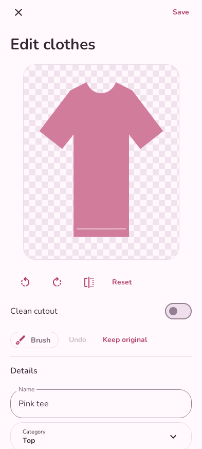
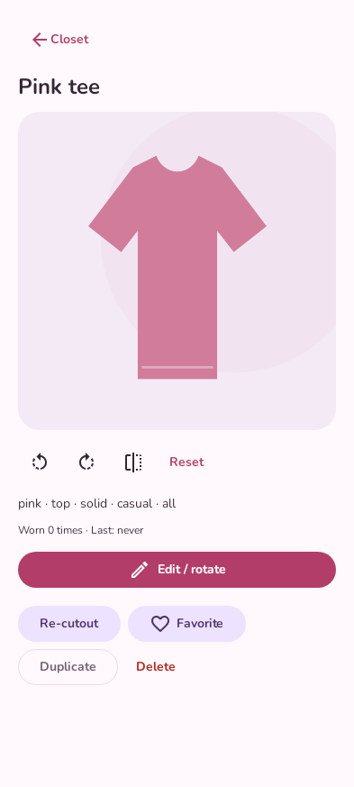
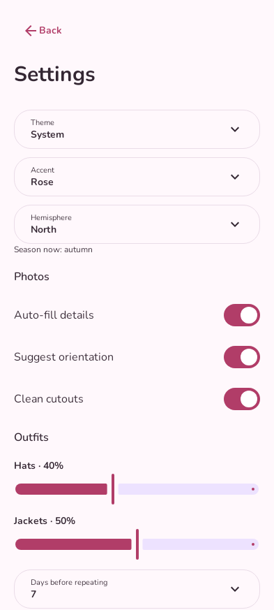

# Closet

Your clothes, together.

An offline Android wardrobe: photograph your clothes, clean up their backgrounds, and mix them into outfits. No accounts, ads, subscriptions, or paid APIs.

<p align="center">
  
  
  
</p>
<details><summary>Editing, item details, and settings</summary>
<p align="center">
  
  
  
</p>
</details>

*Rendered from the app's actual interface with an illustrated example wardrobe. Personal photos are not included. UI updates include refreshed screenshots; CI checks that they match the current source.*

## Features

- Camera capture and multi-photo queue with review and **Save all**.
- On-device cutouts, aligned erase/restore brush, rotation, mirroring, and original-photo fallback.
- Editable color, category/type, pattern, formality, season, and name suggestions; optional tag-text scanning.
- Toggleable crop, edge cleanup, and gentle brightening with before/after preview.
- Search, category filters, sorting, grid size, item favorites, duplication, and multi-delete.
- Occasion-based outfit options, piece locks/swaps, short matching explanations, and local like/dislike preferences.
- Saved outfits, favorites, renaming, wear history, and single-PNG export/sharing.
- Theme/accent settings, automatic seasons, repeat preferences, and complete ZIP backup/restore.
- Rounded responsive layouts, system font scaling, dark mode, and finite motion.

## Install

Requires Android 8.0 or newer. Automatic cutouts also require compatible Google Play services.

1. Open [Actions → Android debug APK](https://github.com/chick-wasabi/closet-android/actions/workflows/android.yml).
2. Choose the latest successful `main` run and download **Closet-debug** under **Artifacts**.
3. Unzip the download and open `app-debug.apk` on your phone. Allow installation from your browser or file manager when Android asks.
4. Install updates over the existing app to retain its wardrobe. Distributed debug and release builds use the same permanent signing identity.

Use APKs from the same official signing identity for updates. See [Android signing](docs/SIGNING.md) if Android reports a certificate mismatch; do not uninstall a populated collection without preserving what you need.

## Use Closet

1. **Add clothes** from the camera or gallery. Wait for the queue, check suggested details in **Review / fix**, then **Save all**. Every suggestion is editable; “Auto” marks fields still using a guess.
2. Open a piece for a larger preview, rotation, favorites, wear counts, duplication, or editing. The editor keeps original and cutout pixels aligned for the restore brush. **Reset** undoes the current orientation preview.
3. In **Outfits**, choose an occasion and filters, then **Shuffle**. Swipe through up to five distinct options. Lock pieces to keep them during the next shuffle; swap individual slots manually. Sleep uses pajamas. Like/dislike affects pair scores only on this device.
4. Save a look, rename it in **Saved**, and tap **Wore this today** to record history. Recently worn pieces receive a configurable scoring penalty.
5. Open the gear for appearance, hemisphere, photo-processing and outfit settings. **Export backup** saves an editable closet ZIP; **Restore backup** replaces the current collection after confirmation.

Good light and a plain background improve cutouts. ML Kit Subject Segmentation may need an initial model download through Google Play services. Image labeling and Latin-script text recognition models are bundled. The brush and original-image option remain available if detection fails.

Suggestions are heuristics, not fashion expertise: orientation, garment type, and pattern can be wrong. Shoes have no universally correct toe direction, so ambiguous masks stay unchanged. Cleanup keeps the largest foreground component, which can remove intentionally separate pieces; turn it off when needed. It cannot unfold sleeves or remove wrinkles. A small closet may yield fewer than five unique outfits.

## Privacy and storage

Wardrobe details use a local Room database. Originals, cutouts, and outfits stay in private app storage. Closet has no Internet permission. Google Play services manages its model separately; sharing sends only your chosen PNG to the app you select.

The system photo picker grants access only to selected images. Capture uses your camera app. Gallery export requests storage permission only on Android 8–9; newer Android versions use scoped storage.

Uninstalling or clearing app data removes the wardrobe. Automatic system backup is disabled. Use **Settings → Export backup** regularly and keep the ZIP privately outside the app. It contains photos, a portable database snapshot, settings, wear history, and learned pair preferences. PNG export preserves only the outfit picture.

Restore accepts Closet backup format 2, validates entries/images and size limits, then replaces records in one database transaction. Invalid archives leave the existing closet intact. ZIPs are not encrypted; choose a trusted destination. A document provider you choose may sync the backup externally. Closet itself has no network access.

## Development

Kotlin, Jetpack Compose, Material 3, Room, and ML Kit. Minimum SDK 26; compile/target SDK 36. Use JDK 21, Android SDK 36, and Build Tools 35.0.0. The committed wrapper supplies checksum-verified Gradle 8.13.

```sh
./gradlew testDebugUnitTest
./gradlew --max-workers=1 lintDebug
python3 scripts/update_screenshots.py
python3 scripts/update_screenshots.py --check
# Restore the existing permanent signing configuration before packaging:
./gradlew assembleDebug
# With a connected Android device:
./gradlew connectedDebugAndroidTest
```

Packaging fails when permanent signing credentials are absent or mismatched; it never substitutes a generated debug key. See [signing](docs/SIGNING.md), [contributing](CONTRIBUTING.md), and [testing](docs/TESTING.md).

| Path | Purpose |
| --- | --- |
| `app/src/main/java/dev/closet/ui/` | Screens, responsive typography, animation, and state |
| `app/src/main/java/dev/closet/data/` | Room migration, settings, and portable backups |
| `app/schemas/` | Exported database layouts, versions 1 and 2 |
| `app/src/main/java/dev/closet/processing/` | Offline photo analysis, orientation, cleanup, and tag scanning |
| `app/src/main/java/dev/closet/imaging/` | Imports, cutouts, composition, export, and sharing |
| `app/src/main/java/dev/closet/domain/` | Outfit matching |
| `app/src/main/assets/style_rules.json` | Editable style policy |
| `app/src/test/` | Logic tests and Compose render checks |
| `app/src/androidTest/` | Device integration checks |
| `scripts/` | Signing verification and screenshot refresh |

Style policy lives in `style_rules.json` version 2: color harmony, pattern/formality penalties, occasion filters, layering seasons, repeat penalties, and feedback weights. Rules are bundled and require rebuilding after edits. Matching is local and rule-based. Suggestion and cleanup-provider interfaces are reserved for future extensions; no cloud cleanup or online AI is implemented.

[Glossary](GLOSSARY.md) · [Third-party notices](THIRD_PARTY_NOTICES.md)
