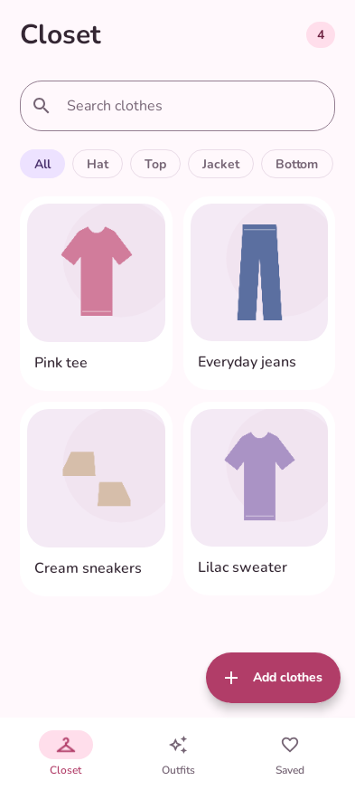

# Closet

Your clothes, together.

An offline Android wardrobe: photograph your clothes, clean up their backgrounds, and mix them into outfits. No accounts, ads, subscriptions, or paid APIs.

<p align="center">
  
  
  
</p>

*Rendered from the app's actual interface with an illustrated example wardrobe. Personal photos are not included. UI updates include refreshed screenshots; CI checks that they match the current source.*

## Features

- Camera capture and multiple-photo imports.
- On-device background removal, an erase/restore brush, and an original-image fallback.
- A searchable wardrobe with category, color, formality, and season details.
- Rule-based outfit suggestions, individual piece swaps, and favorites.
- Export or share an outfit as one transparent PNG.
- Dark mode, system font scaling, rounded controls, and short transitions that follow Android's animation settings.

## Install

Requires Android 8.0 or newer. Automatic cutouts also require compatible Google Play services.

1. Open [Actions → Android debug APK](https://github.com/chick-wasabi/closet-android/actions/workflows/android.yml).
2. Choose the latest successful `main` run and download **Closet-debug** under **Artifacts**.
3. Unzip the download and open `app-debug.apk` on your phone. Allow installation from your browser or file manager when Android asks.
4. Install updates over the existing app to retain its wardrobe. Distributed debug and release builds use the same permanent signing identity.

Use APKs from the same official signing identity for updates. See [Android signing](docs/SIGNING.md) if Android reports a certificate mismatch; do not uninstall a populated collection without preserving what you need.

## Use Closet

Tap **Add clothes**, review each photo, and save its category and details. Add a top, bottom, and shoes before shuffling in **Outfits**. Hats and jackets can join a look. **Saved** holds favorites and provides PNG export and sharing.

Good light and a plain background improve cutouts. ML Kit may need an initial model download through Google Play services. The brush and original-image option work without that model.

## Privacy and storage

Wardrobe details use a local Room database. Originals, cutouts, and outfits stay in private app storage. Closet has no Internet permission. Google Play services manages its model separately; sharing sends only your chosen PNG to the app you select.

The system photo picker grants access only to selected images. Capture uses your camera app. Gallery export requests storage permission only on Android 8–9; newer Android versions use scoped storage.

Uninstalling or clearing app data removes the wardrobe. Automatic backup is disabled. PNG export preserves outfit images, not a complete editable wardrobe backup.

## Development

Kotlin, Jetpack Compose, Material 3, Room, and ML Kit. Minimum SDK 26; compile/target SDK 36. Use JDK 21, Android SDK 36, and Build Tools 35.0.0. The committed wrapper supplies checksum-verified Gradle 8.13.

```sh
./gradlew testDebugUnitTest
./gradlew --max-workers=1 lintDebug
python3 scripts/update_screenshots.py
python3 scripts/update_screenshots.py --check
# Restore the existing permanent signing configuration before packaging:
./gradlew assembleDebug
# With a connected Android device:
./gradlew connectedDebugAndroidTest
```

Packaging fails when permanent signing credentials are absent or mismatched; it never substitutes a generated debug key. See [signing](docs/SIGNING.md), [contributing](CONTRIBUTING.md), and [testing](docs/TESTING.md).

| Path | Purpose |
| --- | --- |
| `app/src/main/java/dev/closet/ui/` | Screens, responsive typography, animation, and state |
| `app/src/main/java/dev/closet/data/` | Local database |
| `app/src/main/java/dev/closet/imaging/` | Imports, cutouts, composition, export, and sharing |
| `app/src/main/java/dev/closet/domain/` | Outfit matching |
| `app/src/main/assets/style_rules.json` | Editable style policy |
| `app/src/test/` | Logic tests and Compose render checks |
| `app/src/androidTest/` | Device integration checks |
| `scripts/` | Signing verification and screenshot refresh |

Style rules are bundled JSON and require rebuilding after edits. Matching is local and rule-based. A suggestion-provider interface is reserved for future extensions; no online AI is implemented.

[Glossary](GLOSSARY.md) · [Third-party notices](THIRD_PARTY_NOTICES.md)
