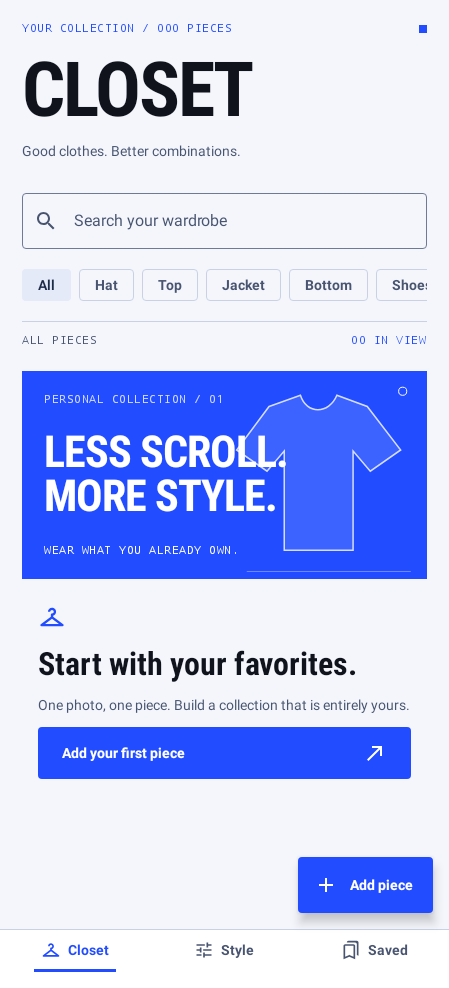
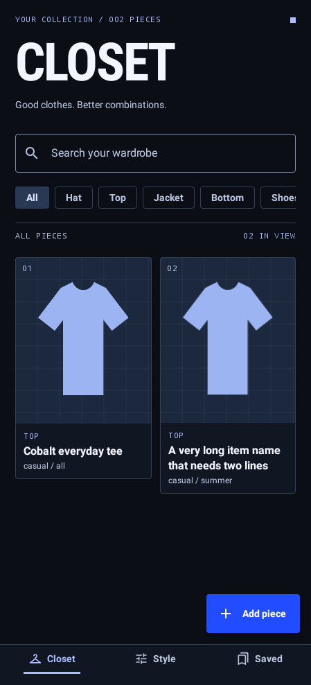
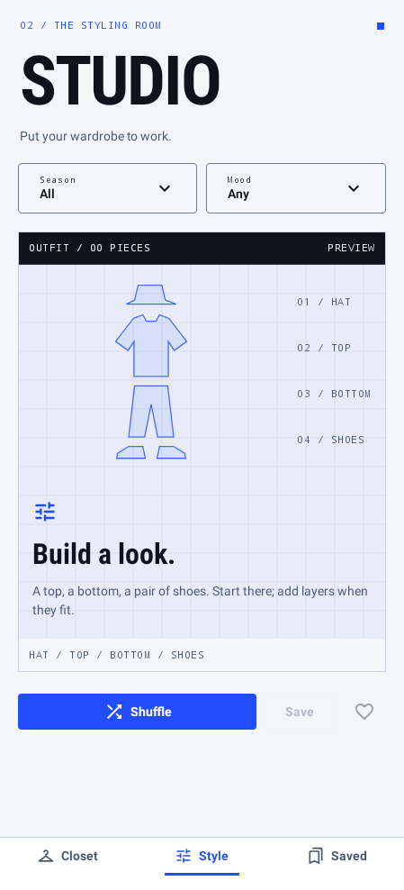
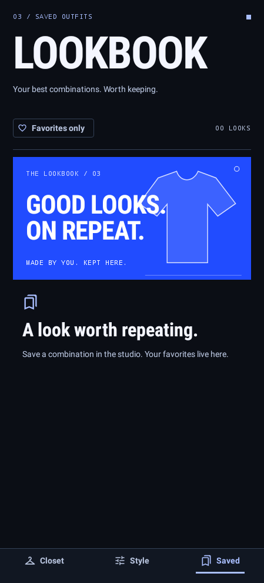

# Reviewed Compose screens

These are actual host-side Compose renders for Closet 1.1, at 449 × 988 density-independent pixels (the OnePlus 13R's approximate content proportions). System bars and physical-device rendering are not represented. The dark closet uses two synthetic drawn-shirt fixtures; the installed app contains no example wardrobe records.

| Closet, light | Closet, dark with test fixtures |
| --- | --- |
|  |  |

| Outfit studio | Saved lookbook, dark |
| --- | --- |
|  |  |

Additional generated checks cover 360 dp width, 1.5× text, landscape scrolling, and the cutout editor. Run `./gradlew testDebugUnitTest` and inspect `app/build/outputs/design-review/` or download the Actions `validation-reports` artifact.
